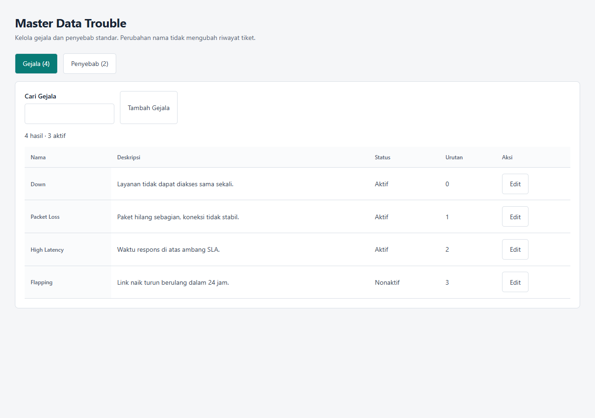
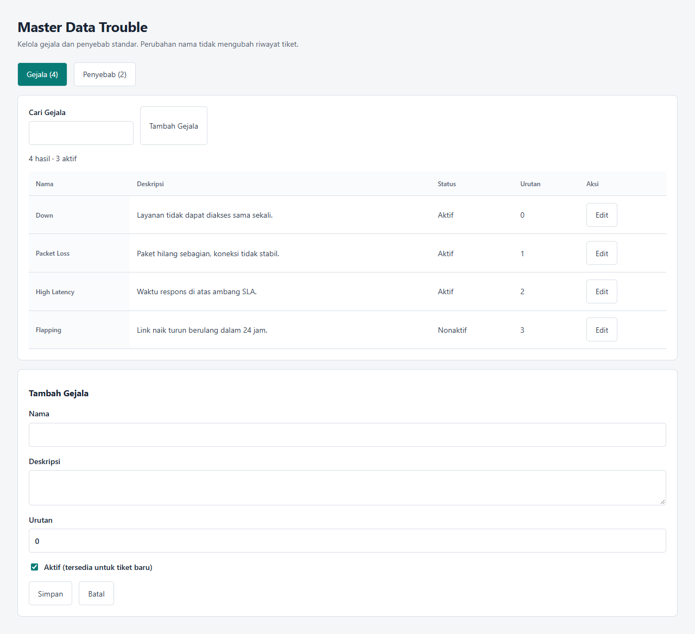
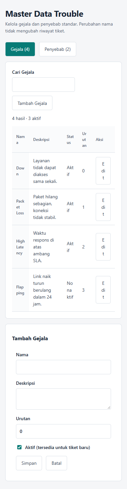
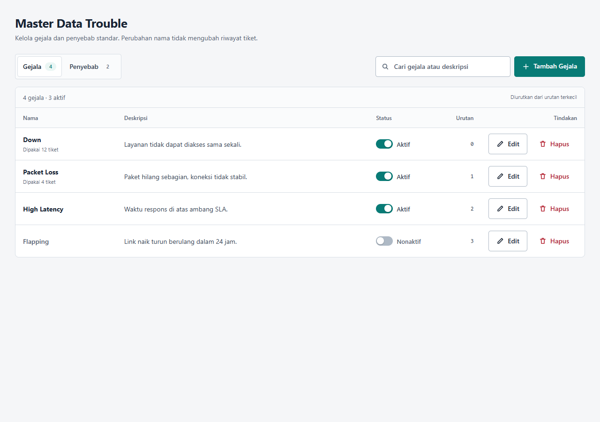
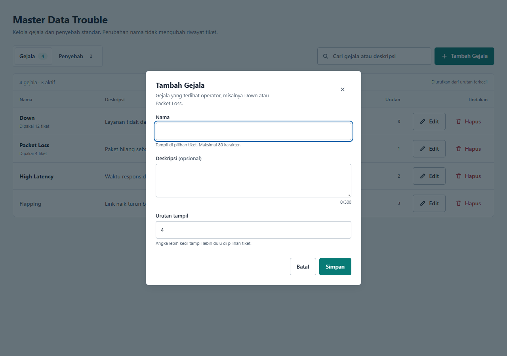
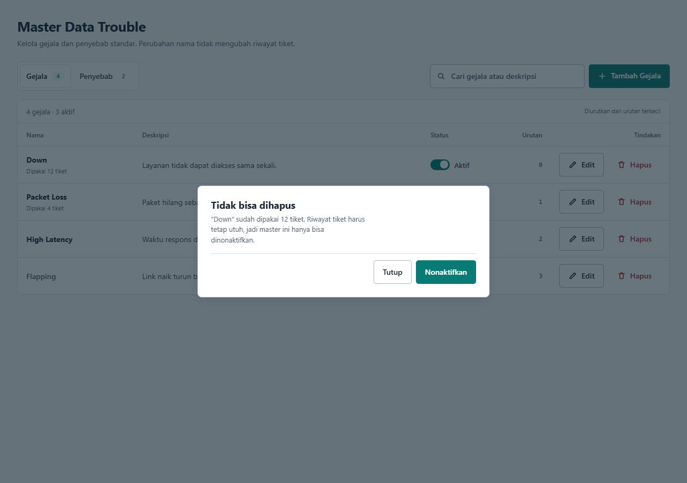
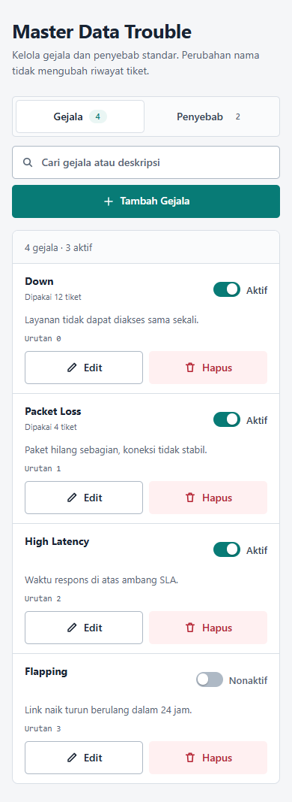
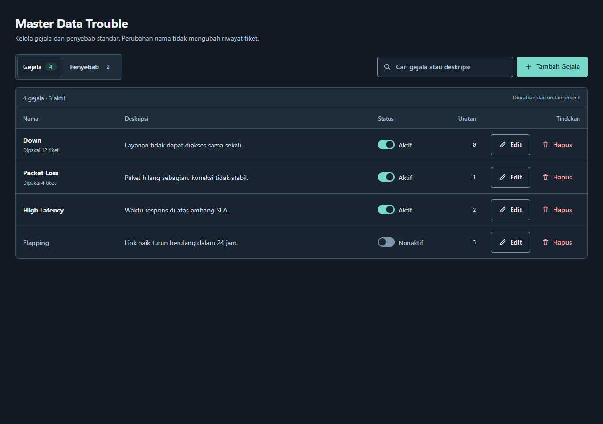

# Master Data Trouble: evaluasi UI/UX dan perbaikan

Tanggal: 2026-10-24
Halaman: `/settings/trouble-masters` (Gejala & Penyebab)
Status: diterapkan dan diuji dengan fixture browser, bukan database live.

## Ringkasan

Tiga keluhan yang dilaporkan terkonfirmasi di render nyata:

1. Tombol **Tambah Gejala** tampil seperti tombol sekunder tanpa aksen, dan tombol **Simpan** di form juga putih. Penyebabnya aturan turunan `.actions button` (spesifisitas 0,1,1) mengalahkan `.btn-primary` (0,1,0), ditambah tombol tambah tidak pernah diberi varian primer.
2. Form muncul **di bawah tabel**: pada viewport 1280×900 form mulai di `y=680` dan halaman menjadi 1168px, jadi setelah menekan tombol di atas user harus scroll untuk menemukan form. Di 390px form berada setelah daftar, sekitar `y=1060`.
3. Hanya ada tombol **Edit**. Tidak ada hapus, tidak ada aksi status langsung, dan `active` hanya bisa diubah lewat checkbox di dalam form. Jadi CRUD-nya sebenarnya C-R-U.

Masalah lain yang ikut ditemukan: status hanya teks tanpa sinyal visual, urutan berupa angka tanpa konteks, galat duplikat tampil di atas daftar sementara form di bawah (galat tidak terlihat saat menyimpan), dan pada 320/390px tabel 5 kolom memaksa teks pecah menjadi "Nam a", "Stat us", "E di t" (lolos uji "tanpa scroll horizontal" tapi tidak terbaca).

## Bukti sebelum perbaikan

| Desktop 1280×900 | Form terbuka (di bawah lipatan) |
|---|---|
|  |  |

| Mobile 390px (tabel pecah) |
|---|
|  |

## Riset rujukan

- Nielsen Norman Group, *Data Tables: Four Major User Tasks*: tabel harus mendukung menemukan record, membandingkan, melihat/mengedit/menambah satu record, dan mengambil aksi. Untuk satu record, tampilan sebagai satu kesatuan (panel/dialog) lebih tepat daripada baris tabel yang sempit; aksi per record harus terlihat, dan identifier manusiawi ada di kolom pertama. <https://www.nngroup.com/articles/data-tables/>
- Raw Studio, *5 Quick Checks to Fix Data Table UX for Enterprise Teams*: edit per record sebaiknya lewat side panel/non-modal, status simpan eksplisit, kegagalan simpan harus menunjuk field yang gagal, empty/error state harus memberi langkah berikutnya, dan pada layar sempit daftar kartu dengan label per nilai lebih terbaca daripada tabel yang dipadatkan. <https://raw.studio/blog/data-table-ux>

## Keputusan desain

Kerangka: toolbar (switch jenis + pencarian + aksi utama) → ringkasan hasil → satu panel daftar. Satu aksi utama (Tambah) memakai aksen teal; aksi baris bersifat sekunder; hapus memakai token destruktif.

- **Aksi utama pindah ke toolbar kanan** dengan ikon plus dan isi aksen penuh, 44px. Tidak lagi menumpang di samping input pencarian dengan tinggi ikut melar.
- **Form jadi dialog** (`<dialog>` + `showModal()`), bukan panel di bawah tabel. Fokus masuk ke field Nama, ESC menutup, fokus kembali ke tombol pemicu, dan galat validasi tampil di dalam dialog tepat di atas tombol Simpan.
- **CRUD lengkap dan eksplisit**: Tambah (toolbar), Edit (baris), Hapus (baris, dengan konfirmasi), plus switch Aktif/Nonaktif langsung di baris. Status tidak lagi disembunyikan di dalam form.
- **Hapus yang jujur**: `Ticket.symptomId`/`causeId` memakai `onDelete: Restrict`, jadi master yang sudah dipakai tiket tidak bisa dihapus. Daftar kini membawa `usageCount`; baris menampilkan "Dipakai N tiket", dan dialog hapus menjelaskan batasannya serta menawarkan Nonaktifkan, bukan tombol mati tanpa alasan.
- **Inline feedback**: duplikat nama dicek di klien sebelum request, balasan 409 server tetap ditangani; sukses muncul sebagai strip status dan baris baru diberi kilau latar singkat.
- **Mobile-first**: di bawah 40rem tabel berubah menjadi daftar kartu (nama + status di baris atas, deskripsi, urutan, lalu Edit/Hapus selebar kartu) dengan `role` tabel dipertahankan agar semantik tidak hilang.
- **Empty state dibedakan**: belum ada data (aksi Tambah) vs tidak ada hasil pencarian (Bersihkan pencarian).
- **Token, bukan warna baru**: seluruh warna memakai `--ui-*`/role yang sudah ada (`--secondary-color`, `--danger-text`, `--ui-tint`), termasuk dark mode.

## Verifikasi terukur

Perintah:

```sh
npm run lint                                  # exit 0
node scripts/test_trouble_master_ui.cjs       # PASS
node scripts/_design-review/audit-master-ui.cjs
node scripts/_design-review/capture-master-ui.cjs
```

Hasil pengukuran (bukan klaim):

- Dialog: `y=179..721` pada viewport 900px, light dan dark. Form tidak lagi berada di bawah daftar.
- Overflow horizontal: 0px pada 320px dan 390px. Semua tombol ≥ 44px pada 320px (diuji di `test_trouble_master_ui.cjs`).
- Kontras terukur (WCAG AA teks 4.5:1):
  - light: tombol primer 5.12:1 (hover 6.83:1), tombol sekunder 15.82:1, hapus 6.51:1, tombol hapus permanen di dialog 6.51:1, teks muted 6.05:1, header tabel 5.84:1, chip tab 4.63:1.
  - dark: tombol primer 8.88:1 (hover 10.66:1), sekunder 13.86:1, hapus 8.88:1, tombol hapus permanen di dialog 8.35:1, teks muted 8.26:1, chip tab 7.01:1.
- Semua kontrol punya nama aksesibel (0 temuan), fokus masuk dialog, Tab tetap di dalam dialog, ESC menutup.
- Uji interaksi mencakup: buat, duplikat ditolak di dialog, edit, switch status, pindah jenis, pencarian + empty state, hapus terkonfirmasi, penjagaan master terpakai, layout 320px, target 44px.

## Sesudah

| Daftar | Dialog | Konfirmasi hapus |
|---|---|---|
|  |  |  |

| Mobile 390px | Dark mode |
|---|---|
|  |  |

## File yang berubah

- `app/settings/trouble-masters/TroubleMastersClient.js` — ditulis ulang (dialog, switch status, aksi hapus, empty state, feedback).
- `app/settings/trouble-masters/masters.module.css` — ditulis ulang mobile-first dengan token yang ada.
- `app/api/trouble-masters/route.js` — `GET` menyertakan `usageCount`.
- `app/api/trouble-masters/[id]/route.js` — `DELETE` baru dengan penjagaan pemakaian tiket; parsing id dipakai bersama `PATCH`.
- `lib/tickets/troubleMasters.js` — pemetaan galat `P2003`.
- `docs/TROUBLE_CLASSIFICATION.md` — dokumentasi master data dan verifikasi.
- `scripts/test_trouble_master_ui.cjs` — diuji ulang untuk alur dialog, switch, dan hapus.
- `scripts/_design-review/` — harness render + audit kontras (fixture, bukan test CI).

## Tindak lanjut

- `app/settings/service-work-types/ServiceWorkTypesClient.js` memakai pola lama yang sama (form di bawah tabel, tombol tambah tanpa varian, hanya Edit, `select` native). Perbaikan yang sama layak diterapkan agar konsisten.
- Pertimbangkan menarik varian tombol dan dialog ke komponen bersama supaya aturan spesifisitas seperti `.actions button` tidak terulang di halaman lain.
- `usageCount` menambah satu subquery pada `GET`; bila master tumbuh sangat besar, pindahkan hitungan ke endpoint terpisah atau cache.
