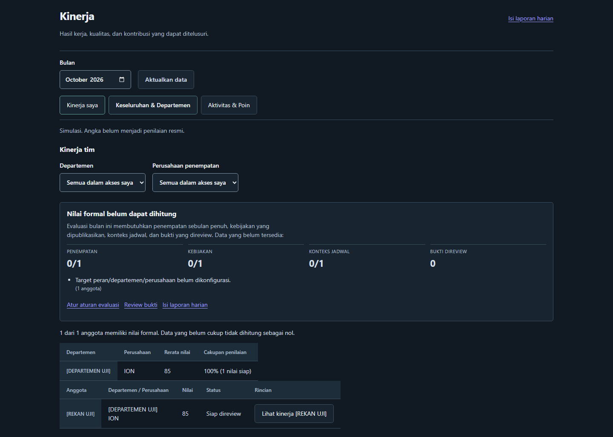

# UI consistency release (7ae7fb8)

Tanggal: 2026-10-24 (Asia/Jakarta)
Host: `ewo` (10.16.124.242), user deploy `nochspnet`, akses lewat jump server.
Aplikasi: Docker Compose project `noc-manager2` di `/home/nochspnet/noc-manager2`.

## Isi rilis

Commit `7ae7fb880931bfeef591cca5cbdaaa324397651e`:

- Master Data Trouble dan Jenis Pekerjaan Layanan: dialog tambah/edit, aksi baris Edit/Hapus, switch status, jumlah tiket pemakai, empty state terpisah, daftar kartu di layar sempit.
- `MasterPicker` (combobox select-only) untuk form master dan form tiket (jenis pekerjaan, Department, PIC).
- Konsistensi tombol/label/tabel di Pengaturan, Laporan, Tiket, dan Dashboard.
- Endpoint `DELETE` bertingkat untuk trouble-masters dan service-work-types dengan penjagaan pemakaian tiket dan `usageCount` pada `GET`.
- Perbaikan harness tes form tiket (stub `node:crypto`, CSS outdir) dan penulisan ulang dua tes UI yang stale.

Tidak ada perubahan schema Prisma atau migrasi data.

## Artefak

- Image dasar: `noc-manager2-app:release-v3-theme-6ea74c6`
- Image rilis: `noc-manager2-app:release-7ae7fb8`
  - label `org.opencontainers.image.revision=7ae7fb880931bfeef591cca5cbdaaa324397651e`
  - dibangun dari image dasar + `app/`, `components/`, `lib/` commit baru, lalu `npm run build`
- Direktori rilis: `/opt/noc-manager2/releases/ui-consistency-7ae7fb8`
  - `Dockerfile`, `release.yml`, `rollback.yml`, `rollback.sh`, `build.log`, `RELEASE.txt`
- Backup database sebelum deploy: `/opt/noc-manager2/backups/pre-7ae7fb8-20261024T165957Z.dump` (20.5 MB, format custom)

## Deploy

```sh
cd /home/nochspnet/noc-manager2
git merge --ff-only origin/main            # 6ea74c6 -> 7ae7fb8
docker build -f /opt/noc-manager2/releases/ui-consistency-7ae7fb8/Dockerfile \
  -t noc-manager2-app:release-7ae7fb8 .
docker compose -p noc-manager2 -f docker-compose.prod.yml \
  -f /opt/noc-manager2/releases/ui-consistency-7ae7fb8/release.yml \
  up -d --no-deps --no-build app
```

## Verifikasi

- Container `noc-manager2-app-1` berjalan dengan image `release-7ae7fb8`, `RestartCount=0`.
- Log start: `✓ Ready in 261ms`, cron `schedule_cron.js` aktif, tidak ada error Prisma/Next.
- `http://127.0.0.1:3000/login` → 200; `/dashboard`, `/settings/trouble-masters`, `/settings/service-work-types`, `/tickets` → 307 (redirect login); `/api/trouble-masters` dan `/api/service-work-types` → 401.
- `http://noc.servicex.id/login` → 307 ke HTTPS.
- Image berisi `components/MasterPicker.js`, `components/master-picker.module.css`, dan referensi picker di `TicketWorkClassification.js`.

## Catatan terbuka

`https://noc.servicex.id` mengembalikan **521** dari reverse proxy publik. Bukti: host aplikasi tidak membuka listener 443 (hanya 3000 via docker-proxy); saat `https://noc.servicex.id/login` diminta, tidak ada paket `GET /login` yang sampai ke port 3000 (0 hit), sementara traffic HTTP/1.1 dari `43.225.64.190` ke aplikasi tetap berjalan normal (mis. `PATCH /api/tickets/...`). Artinya kegagalan ada di lapisan TLS/HTTPS proxy, bukan di container aplikasi. Perlu akses ke proxy tersebut (bukan host `ewo`) untuk memperbaikinya.

## Rollback

```sh
sudo /opt/noc-manager2/releases/ui-consistency-7ae7fb8/rollback.sh
```

Rollback hanya mengganti image kembali ke `release-v3-theme-6ea74c6`; tidak menyentuh database. Backup database tersedia bila diperlukan pemulihan terpisah.

## Tindak lanjut 3.1.0 (changelog dan versi)

Commit `5a47019` menambahkan `CHANGELOG.md` (Keep a Changelog 1.1.0 + SemVer), panduan
`docs/CHANGELOG_GUIDE.md`, validator `scripts/changelog-check.cjs` dan gate CI, serta menaikkan
`package.json` ke `3.1.0`.

- Image: `noc-manager2-app:release-3.1.0` (dasar `release-7ae7fb8`, label revision `5a47019…`).
- Release dir: `/opt/noc-manager2/releases/ui-consistency-3.1.0` (`Dockerfile`, `release.yml`, `rollback.yml`, `rollback.sh`, `build.log`).
- Backup sebelum switch: `/opt/noc-manager2/backups/pre-3.1.0-20261024T170835Z.dump` (20.5 MB).
- Verifikasi: container `noc-manager2-app-1` Up, `RestartCount=0`, `/login` 200, `/api/trouble-masters` 401, log start `@hendrax5/noc-manager2@3.1.0`.
- Rollback: `sudo /opt/noc-manager2/releases/ui-consistency-3.1.0/rollback.sh` (kembali ke `release-7ae7fb8`).
- Perubahan runtime hanya string versi di navbar; tidak ada migrasi database.

## Tindak lanjut 3.1.1 (kesiapan Kinerja)

Commit `8f11fe3`, image `noc-manager2-app:release-3.1.1` (dasar `release-3.1.0`).

- Tab tim Kinerja menampilkan panel kesiapan: jumlah anggota dengan penempatan sebulan penuh, kebijakan published, konteks jadwal, bukti direview, serta alasan penghambat teratas. API overview menyertakan `readiness` dan `reasons` per anggota.
- Audit produksi 2026-10 saat rilis: 0 penempatan, 0 kebijakan published, 0 konteks bulanan, 0 bukti direview, 0 laporan harian submitted, 0 fase selesai. Karena itu semua nilai tetap `null` sampai konfigurasi dan bukti diisi; ini bukan regresi UI.
- Backup sebelum switch: `/opt/noc-manager2/backups/pre-3.1.1-20261024T172246Z.dump` (20.5 MB).
- Verifikasi: container `noc-manager2-app-1` Up, `RestartCount=0`, `/login` 200, `/api/reports/kinerja/overview` 401, log start `@hendrax5/noc-manager2@3.1.1`.
- Rollback: `sudo /opt/noc-manager2/releases/ui-consistency-3.1.1/rollback.sh` (kembali ke `release-3.1.0`).

Bukti tampilan panel kesiapan (fixture QA, bukan data produksi):



## Tindak lanjut 3.2.0 (aktivitas tim)

Commit `db3877b`, image `noc-manager2-app:release-3.2.0` (dasar `release-3.1.1`).

- Tab tim Kinerja menampilkan **Peringkat aktivitas bulan ini** dari data operasional nyata: tiket selesai (resolvedAt dalam bulan), komentar/respons (createdAt dalam bulan), dan poin ledger `TicketHistory.awardedScore` + `Ticket.awardedScore`.
- Ringkasan produksi Oktober saat rilis: 2.867 tiket selesai, 7.599 komentar, 23.361 poin ledger, 84 user aktif (seluruh cakupan; angka per user mengikuti scope akses).
- Tampilan tetap memisahkan aktivitas operasional dari evaluasi formal berbasis bukti. Panel kesiapan tetap menjelaskan mengapa nilai formal `null`.
- Backup sebelum switch: `/opt/noc-manager2/backups/pre-3.2.0-20261024T173333Z.dump` (20.5 MB).
- Verifikasi: container Up, `RestartCount=0`, `/login` 200, `/api/reports/kinerja/overview` 401, log start `@hendrax5/noc-manager2@3.2.0`.
- Rollback: `sudo /opt/noc-manager2/releases/ui-consistency-3.2.0/rollback.sh` (kembali ke `release-3.1.1`).

## Tindak lanjut 3.3.0 (skor aktivitas)

Commit `c45a9f3`, image `noc-manager2-app:release-3.3.0` (dasar `release-3.2.0`).

- Skor aktivitas 0-100 per anggota: **40% poin + 35% tiket selesai + 25% respons**, masing-masing dinormalisasi terhadap nilai tertinggi pada filter aktif. Tabel diurutkan berdasarkan skor.
- Skor ini operasional dan terpisah dari evaluasi formal berbasis bukti. Panel kesiapan tetap menjelaskan mengapa nilai formal masih `null`.
- Backup sebelum switch: `/opt/noc-manager2/backups/pre-3.3.0-20261024T173924Z.dump` (20.5 MB).
- Verifikasi: container Up, `RestartCount=0`, `/login` 200, API Kinerja 401, log start `@hendrax5/noc-manager2@3.3.0`.
- Rollback: `sudo /opt/noc-manager2/releases/ui-consistency-3.3.0/rollback.sh` (kembali ke `release-3.2.0`).

## Tindak lanjut 3.4.0 (peringkat per departemen)

Commit `4a6e346`, image `noc-manager2-app:release-3.4.0` (dasar `release-3.3.0`).

- Skor aktivitas dinormalisasi di dalam cohort **departemen + perusahaan**; peringkat memakai competition rank per cohort. Tabel tim diurutkan per departemen lalu peringkat, sehingga setiap departemen memiliki peringkat 1..n sendiri.
- Peringkat pribadi dihitung dari departemen anggota sendiri. Staf tetap tidak menerima daftar rekan; hanya peringkat dan skor dirinya. Manager melihat departemen yang granted; Admin melihat semua.
- Unit test `lib/reports/activityScore.test.mjs` (3 kasus: normalisasi per departemen, pemisahan perusahaan, seri) lulus.
- Backup sebelum switch: `/opt/noc-manager2/backups/pre-3.4.0-20261024T180106Z.dump` (20.5 MB).
- Verifikasi: container Up, `RestartCount=0`, `/login` 200, API Kinerja 401, log start `@hendrax5/noc-manager2@3.4.0`.
- Rollback: `sudo /opt/noc-manager2/releases/ui-consistency-3.4.0/rollback.sh` (kembali ke `release-3.3.0`).
